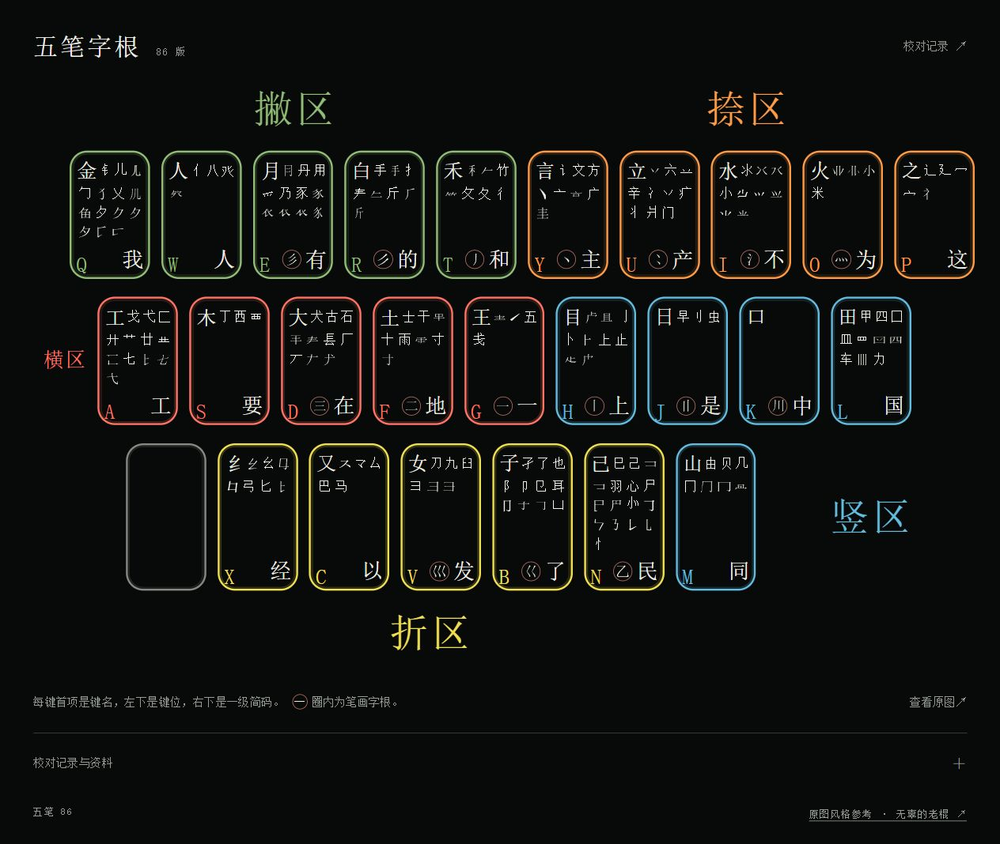

# 五笔学习站

可独立部署到主站 `/wubi/` 的静态学习站。当前提供五笔 86 字根速查，采用宋体、暗色五区配色，包含 216 项字根和 16 项圈内笔画。



## 本地预览与检查

需要 Node.js 20 或更新版本。站点构建使用 Node 内置模块，克隆仓库后可直接运行。

```sh
npm run dev
# 浏览器打开 http://127.0.0.1:4386/wubi/
npm run check
```

修改源文件后重新执行构建或预览命令，再刷新页面。

## 构建与部署

```sh
npm run build
```

将 `dist/` 内的文件复制到服务器为 `/wubi/` 提供服务的目录，浏览器访问 `https://你的域名/wubi/`。保留静态文件的相对目录结构，并将无尾斜线的 `/wubi` 转向 `/wubi/`。站点自己管理导航和主题，主站可先添加指向该地址的链接。

检查其他前缀可运行 `npm run preview -- --base /preview/wubi/`。

`dist/index.html` 同时保留离线双击查表能力。正式部署验收通过网址完成。生成目录由 Git 忽略，仓库原始资料和绘图工具只在本地使用。

## 仓库结构

| 目录 | 用途 |
| --- | --- |
| site | 首页、导航、页脚、全站样式及页面逻辑 |
| features/root-chart/src | 可挂载和卸载的字根图组件、作用域样式 |
| features/root-chart/data | 当前浏览器使用的五笔 86 数据 |
| features/root-chart/scripts | 字形生成、预览和校验工具 |
| features/root-chart/docs | 逐键勘误、参考资料及局部维护说明 |
| scripts | 静态构建、带路径前缀的本机预览和发布检查 |
| tools/qa | 浏览器验收脚本、axe 及许可证 |
| docs/history | 原始反馈、版本截图和资料归档索引 |
| .qa | 可重新生成的本机输出，Git 忽略 |

## 字根维护

从[字根图维护说明](features/root-chart/docs/README.md)开始，逐键修改依据见[勘误](features/root-chart/docs/勘误.md)。组件调用方式和修改规则见[局部 AGENTS.md](features/root-chart/AGENTS.md)。网页浏览和构建只需 Node，重新绘制片形需要 Python 及对应宋体。

## 版本与验收

- `kaiti-draft-v1` 保存楷体待完善版，`songti-v1` 保存整理前、已通过本机打开与缩放验收的宋体版。
- [历史资料](docs/history/README.md)记录原始修改要求与精选过程稿。[本轮验收](docs/verification.md)记录重组后的检查与限制。
- 参考作者和核对资料保留在页面及字根图文档中。仓库中的第三方参考资料沿用原作者权利，来源见[参考索引](features/root-chart/docs/references/README.md)。

## 后续方向

先增加能引用现有键位数据的五笔教程，再建设在线打字练习，随后根据真实练习结果设计进度、错键和成绩保存。主站确定后再接入具体联动能力。菜单随可用功能扩展。
