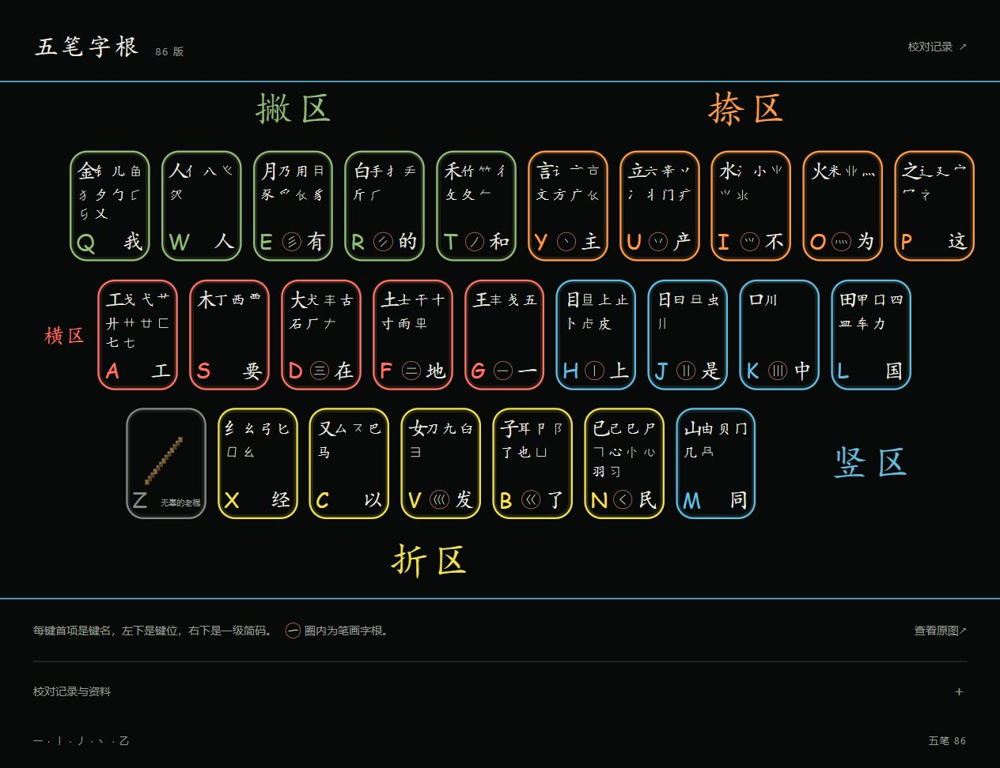
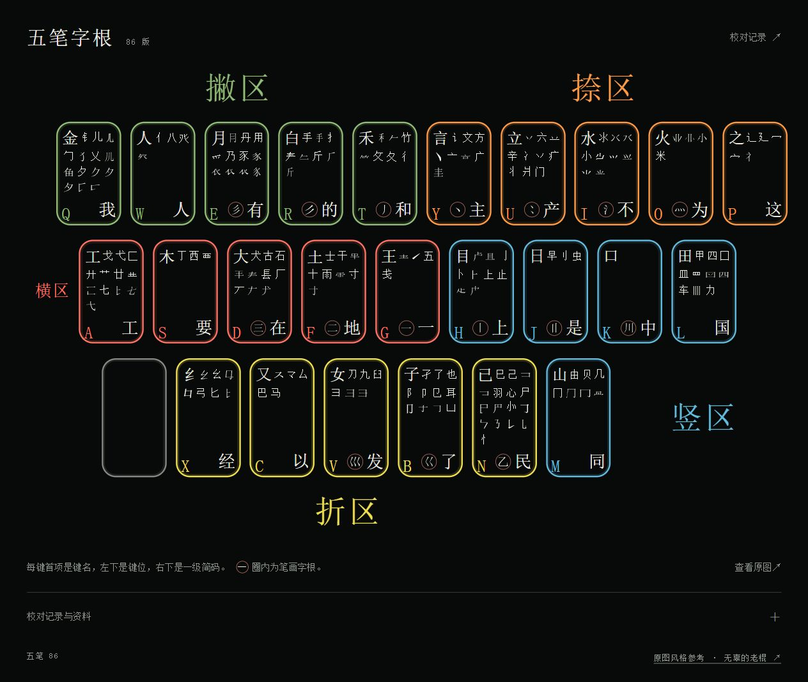

# 版本资料

| 版本 | Git 标签 | 内容 |
| --- | --- | --- |
| 楷体待完善版 | kaiti-draft-v1 | 56811e1，保留楷体试作与当时的片形 |
| 宋体已验收版 | songti-v1 | fad7cbf，本地打开与缩放已由用户确认 |

原始修改要求见 [nextstep.txt](nextstep.txt)，文件去向见 [archive-manifest.md](archive-manifest.md)。精选局部图在 examples 中，当前核形依据与疑点见 [逐键勘误](../../features/root-chart/docs/勘误.md)。
